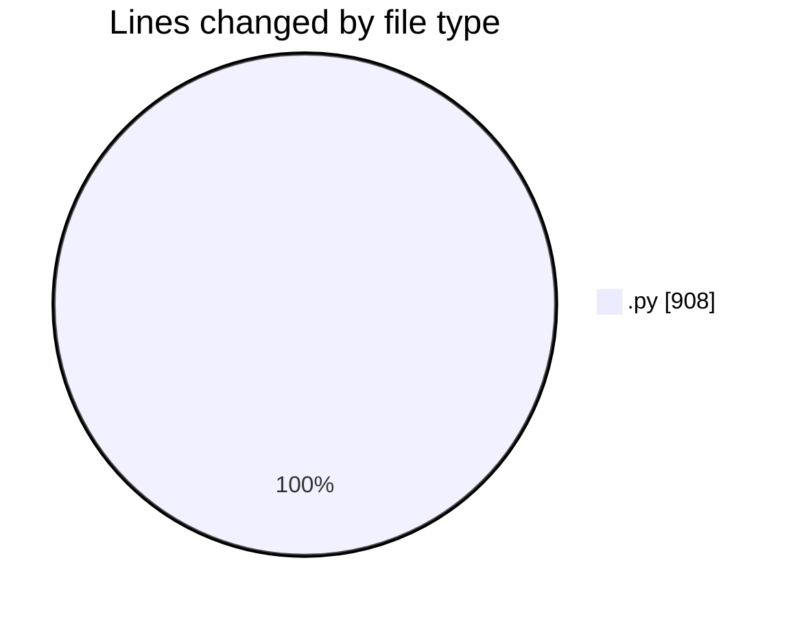
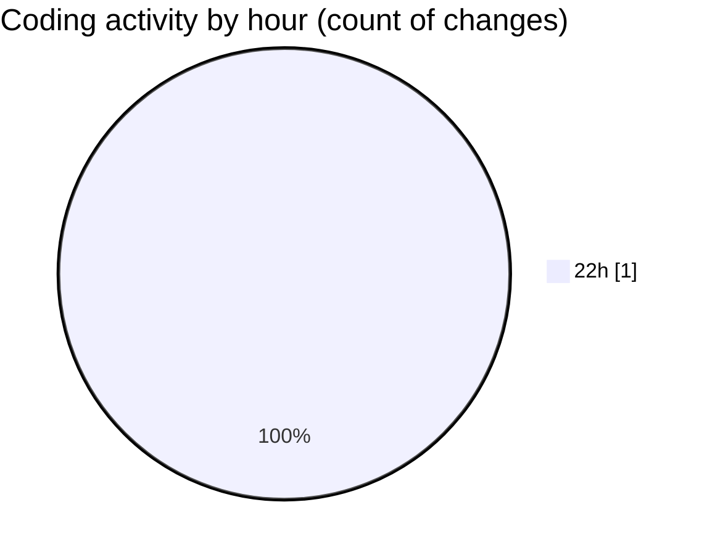

# code-server-sync - Activity Summary 

## Overall Statistics

| Stat                   | Value                                                             |
| ---------------------- | ----------------------------------------------------------------- |
| **Lines Added** (➕)   | 908                                          |
| **Lines Removed** (➖) | 0                                        |
| **Net Change** (↕)    | 908                |
| **Active Time** (⌚)   | 0 minute |

## Modified Files
- **self_test.py** (+908, -0)

## Visualizations

### By File Type (Lines Changed)

### By Hour (Estimated Activity Count)

> **Last Updated:** 2026/10/27 23:00:27